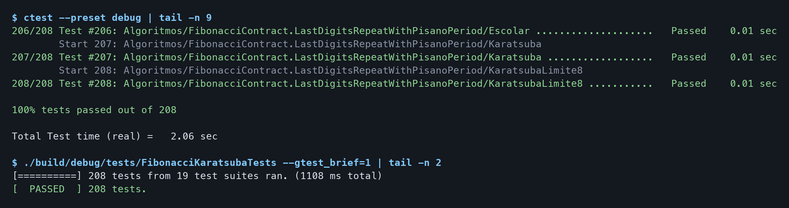
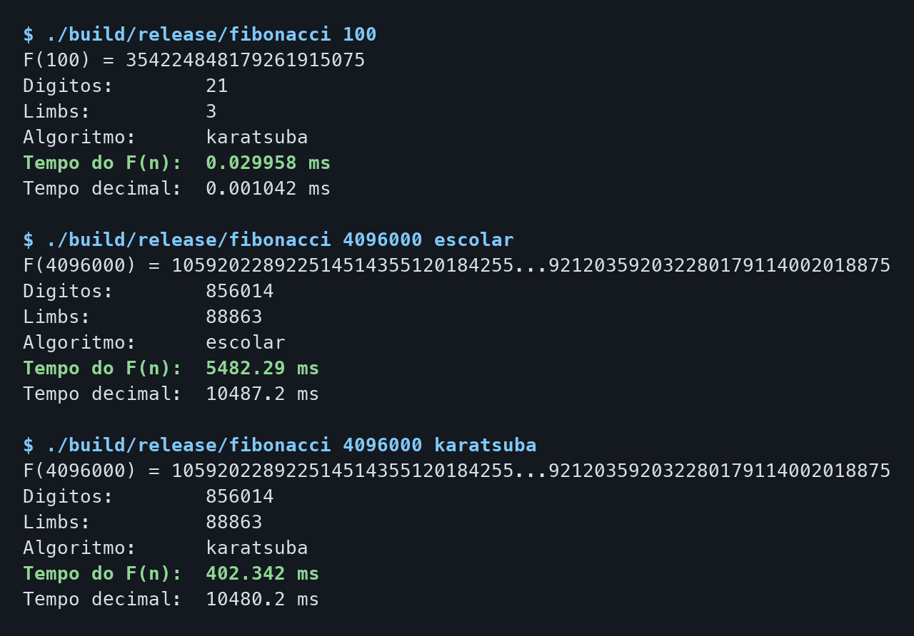
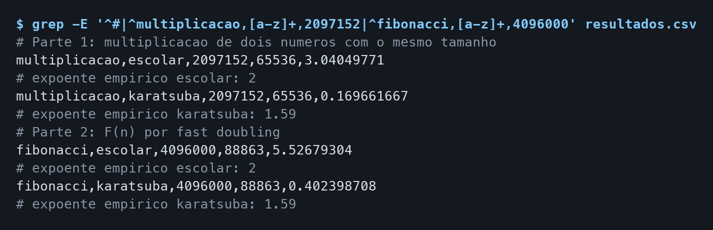
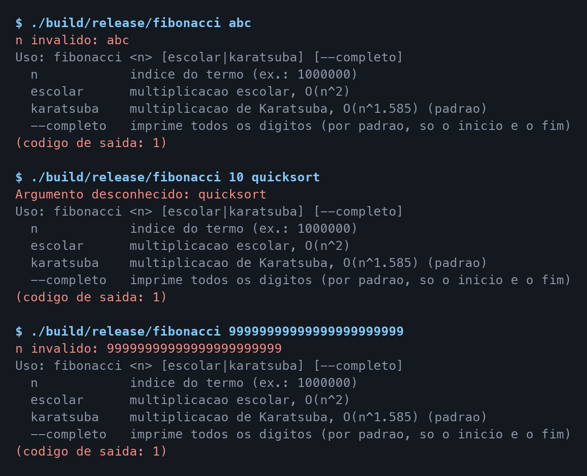

# Fibonacci-Karatsuba — Números de Fibonacci Gigantes e Multiplicação de Inteiros Grandes

**Número da Lista**: 4<br>
**Conteúdo da Disciplina**: Dividir e Conquistar — Multiplicação de Karatsuba e Fibonacci por fast doubling<br>
**Link de Apresentação**: _a definir_

## Alunos

| Matrícula | Aluno                   |
| --------- | ----------------------- |
| 231027159 | Lucas Alves             |
| 231027186 | Samuel Nogueira Caetano |

## Sobre

O **Fibonacci-Karatsuba** é um programa de linha de comando que calcula números de Fibonacci
gigantes, com milhões de dígitos, e usa esse cálculo para comparar dois algoritmos de
multiplicação de inteiros grandes:

- **Multiplicação escolar**: o método do papel, com "dígitos" de 32 bits. Complexidade O(n²).
- **Multiplicação de Karatsuba**: algoritmo de dividir e conquistar que troca 4 multiplicações
  de metade do tamanho por 3. Complexidade O(n^log₂3) ≈ O(n^1,585).

O inteiro de precisão arbitrária foi escrito do zero, sem bibliotecas externas de números grandes.

### Modelagem

- **Número grande**: um vetor de _limbs_ de 32 bits (base B = 2³²), do menos significativo para
  o mais significativo. O produto de dois limbs cabe em 64 bits (`DoubleLimb`), então os carries
  são calculados sem perda.
- **Tamanho da entrada**: `n` é o número de limbs dos fatores. Em F(n), `n` é o índice do termo,
  e o resultado tem cerca de `0,694·n` bits.
- **Algoritmo de multiplicação**: uma interface (`Multiplier`) com duas implementações. O
  `Fibonacci` recebe uma delas pelo construtor, então o mesmo cálculo roda com qualquer algoritmo.

Os principais tipos da biblioteca (`include/bignum/`):

| Estrutura              | Tipo                  | Papel                                                         |
| ---------------------- | --------------------- | ------------------------------------------------------------- |
| `BigInt`               | `vector<uint32_t>`    | Inteiro não negativo: conversão, comparação, `+`, `-`, `/`, `%` |
| `Multiplier`           | interface             | Contrato comum dos dois algoritmos de multiplicação           |
| `SchoolbookMultiplier` | `final : Multiplier`  | Multiplicação escolar, O(n²)                                  |
| `KaratsubaMultiplier`  | `final : Multiplier`  | Karatsuba com limite de recursão configurável (padrão: 32)    |
| `Fibonacci`            | recebe um `Multiplier` | F(n) por fast doubling, além de uma versão só com somas       |

### Algoritmo de Karatsuba

Implementado em `KaratsubaMultiplier::multiplyLimbs`. Cada fator é dividido em uma metade alta e
uma metade baixa, com m limbs:

```
x = x1·B^m + x0        y = y1·B^m + y0

z0 = x0·y0
z2 = x1·y1
z1 = (x0 + x1)·(y0 + y1) − z0 − z2

x·y = z2·B^(2m) + z1·B^m + z0
```

1. **Dividir**: separar cada fator nas metades `x1, x0` e `y1, y0`.
2. **Conquistar**: calcular `z0`, `z2` e `(x0 + x1)·(y0 + y1)` recursivamente, com 3
   multiplicações em vez de 4.
3. **Combinar**: obter `z1` por subtração e somar as três partes deslocadas, em tempo O(n).

Recorrência e solução pelo Teorema Mestre (a = 3, b = 2, f(n) = O(n)):

```
T(n) = 3·T(n/2) + O(n)   ⇒   T(n) = O(n^log₂3) ≈ O(n^1,585)
```

Quando o menor fator tem até 32 limbs, a recursão para e usa a multiplicação escolar, que é mais
rápida para números pequenos. O limite foi escolhido por medição: em 64 limbs, o Karatsuba já
gasta 15% menos tempo que a escolar (1,73 µs contra 2,04 µs).

### Fibonacci por fast doubling

Implementado em `Fibonacci::compute`, a partir de duas identidades:

```
F(2k)   = F(k)·(2·F(k+1) − F(k))
F(2k+1) = F(k)² + F(k+1)²
```

A partir de (F(k), F(k+1)), o algoritmo percorre os bits de n do mais alto para o mais baixo,
dobrando k a cada bit. São 3 multiplicações por bit, e os números dobram de tamanho a cada passo,
então o tempo é dominado pelas últimas multiplicações. Por isso o custo de F(n) segue o custo da
multiplicação: O(n²) com a escolar e O(n^1,585) com o Karatsuba.

### Complexidade

Seja `n` o número de limbs dos fatores (ou o índice, no caso de F(n)):

| Operação                        | Tempo          |
| ------------------------------- | -------------- |
| Soma e subtração                | O(n)           |
| Multiplicação escolar           | O(n²)          |
| Multiplicação de Karatsuba      | O(n^1,585)     |
| F(n) com a escolar              | O(n²)          |
| F(n) com o Karatsuba            | O(n^1,585)     |
| F(n) só com somas               | O(n²)          |
| Conversão para decimal (`toString`) | O(n²)      |

### Resultados

Medidos com `fibonacci_benchmark 3`, em Release (`-O3`), em um Apple M5 com Apple clang 21. Os
tempos variam de máquina para máquina, mas os expoentes não deveriam variar. O expoente empírico é
a inclinação da reta de log(tempo) × log(tamanho), calculada por regressão linear sobre as 4
maiores medições.

|                                    | Escolar | Karatsuba | Teoria        |
| ---------------------------------- | ------- | --------- | ------------- |
| Expoente empírico na multiplicação | 2,00    | 1,59      | 2 e 1,585     |
| Expoente empírico em F(n)          | 2,00    | 1,59      | 2 e 1,585     |

|                                                              | Escolar | Karatsuba | Ganho           |
| ------------------------------------------------------------ | ------- | --------- | --------------- |
| Multiplicar dois números de 65.536 limbs (2 milhões de bits) | 3,04 s  | 0,17 s    | 18× mais rápido |
| F(4.096.000), com 856 mil dígitos                            | 5,53 s  | 0,40 s    | 14× mais rápido |

Dobrar o tamanho da entrada multiplica o tempo por 4 na escolar e por 3 no Karatsuba, como a teoria
prevê: de 32.768 para 65.536 limbs, a escolar vai de 0,75 s para 3,04 s (4,0×), e o Karatsuba, de
0,056 s para 0,170 s (3,0×).

Em F(n), a recursão do Karatsuba começa por volta de n = 3.000, quando os fatores passam de 32
limbs. Com poucos níveis de recursão o ganho ainda é pequeno, e até n = 8.000 os dois tempos
coincidem. A diferença aparece a partir de n = 16.000 (82 µs contra 59 µs) e só cresce depois disso.

### Por que isso importa

A multiplicação de Karatsuba foi o primeiro algoritmo a quebrar a barreira de O(n²) e ainda é usada
na prática: o `int` do **CPython**, o `BigInteger` do **Java** e a biblioteca **GMP** a aplicam em
uma faixa de tamanhos, junto com a multiplicação escolar para números pequenos. É a mesma
estratégia híbrida deste projeto.

## Screenshots

### 1. Suíte de testes — 208 testes, 19 suítes

Os testes cobrem o `BigInt`, os dois multiplicadores e o Fibonacci, tanto pelo CTest quanto
executando o binário de testes direto.



### 2. Calculando F(n) com os dois algoritmos

F(4.096.000) tem 856.014 dígitos. Os dois algoritmos chegam ao mesmo número, mas o Karatsuba leva
0,4 s, contra 5,5 s da multiplicação escolar. O **Tempo decimal** é a conversão para texto, igual
nos dois casos.



### 3. Benchmark

Trecho do CSV gerado pelo `fibonacci_benchmark`, com a maior medição comum aos dois algoritmos em
cada parte e os expoentes empíricos, que ficam em 2 e 1,59.



### 4. Tratamento de erros

Um índice inválido, um algoritmo desconhecido e um índice que não cabe em 64 bits terminam com
código `1` e mostram a ajuda.



## Instalação

**Linguagem**: C++17<br>
**Framework**: GoogleTest (testes) + CMake ≥ 3.21 (build)<br>

### Pré-requisitos

- Compilador com suporte a C++17 acessível como `g++` (no macOS, o `g++` do Xcode é o Apple clang)
- CMake 3.21 ou superior e Ninja
- Acesso à internet na primeira configuração com testes: o GoogleTest (v1.15.2) é **baixado
  automaticamente** pelo CMake, não é preciso instalá-lo
- Opcional: `clang-format` e `clang-tidy`, usados pelos alvos de formatação e análise estática

Instalação das dependências:

```bash
# Ubuntu / Debian / WSL
sudo apt update
sudo apt install build-essential cmake ninja-build

# macOS (Homebrew)
xcode-select --install
brew install cmake ninja
```

### Clonando

```bash
git clone https://github.com/projeto-de-algoritmos-2026/D-C_Fibonacci-Karatsuba.git
cd D-C_Fibonacci-Karatsuba
```

### Compilando

Para uso e benchmark (Release, sem os testes):

```bash
cmake --preset release
cmake --build --preset release
```

São gerados dois executáveis em `build/release/`: `fibonacci` (a CLI) e `fibonacci_benchmark`.

Para os testes (Debug), veja [Executando os testes](#executando-os-testes).

## Uso

### Calcular F(n)

```bash
./build/release/fibonacci <n> [escolar|karatsuba] [--completo]
```

| Argumento                | Significado                                                                                               |
| ------------------------ | --------------------------------------------------------------------------------------------------------- |
| `n`                      | Índice do termo                                                                                           |
| `escolar` ou `karatsuba` | Algoritmo de multiplicação. O padrão é `karatsuba`                                                        |
| `--completo`             | Mostra todos os dígitos. Sem ele, números grandes aparecem só com os 30 primeiros e os 30 últimos dígitos |

Exemplo:

```
$ ./build/release/fibonacci 1000000
F(1000000) = 195328212870775773163201494759...719893411568996526838242546875
Digitos:        208988
Limbs:          21696
Algoritmo:      karatsuba
Tempo do F(n):  42.893 ms
Tempo decimal:  623.939 ms
```

Para comparar os algoritmos, rode o mesmo `n` com `escolar` e com `karatsuba` e compare o **Tempo
do F(n)**.

Códigos de saída: `0` em caso de sucesso e `1` para argumentos inválidos.

### Benchmark

```bash
./build/release/fibonacci_benchmark 3 | tee resultados.csv
```

O argumento é o tempo máximo, em segundos, de uma medição (o padrão é 5): quando uma medição passa
desse valor, a série daquele algoritmo termina. Com 3, a série do F(n) para em n = 4.096.000 na
escolar e em n = 16.384.000 no Karatsuba.

A saída é um CSV com duas partes: a multiplicação isolada (de 16 a 65.536 limbs) e o cálculo de F(n)
(de n = 1.000 a 64 milhões, no máximo). Cada série termina com o expoente empírico. Para gerar
gráficos, use escala logarítmica nos dois eixos: cada algoritmo vira uma reta cuja inclinação é o
expoente.

### Formatação e análise estática

Os alvos só existem se `clang-format` e `clang-tidy` estiverem instalados:

```bash
cmake --build --preset debug --target check     # verifica a formatação
cmake --build --preset debug --target format    # formata os arquivos
cmake --build --preset debug --target tidy      # roda o clang-tidy
cmake --build --preset debug --target lint      # formatação + clang-tidy
cmake --build --preset debug --target fix       # aplica as correções do clang-tidy e formata
```

## Como ele funciona

O projeto separa a biblioteca, que não sabe nada sobre entrada e saída, dos executáveis:

1. **CLI** (`app/main.cpp`): valida os argumentos, escolhe o multiplicador e chama o `Fibonacci`.
   Mede o cálculo e a conversão para decimal separadamente.
2. **Benchmark** (`app/Benchmark.cpp`): mede os dois algoritmos com números aleatórios de semente
   fixa, repetindo cada medição por pelo menos 0,2 s, e calcula o expoente empírico.
3. **Fibonacci** (`src/Fibonacci.cpp`): aplica o fast doubling, sem saber qual multiplicador está
   usando.
4. **Multiplicadores** (`src/SchoolbookMultiplier.cpp` e `src/KaratsubaMultiplier.cpp`): trabalham
   diretamente sobre os limbs. O Karatsuba usa a escolar como caso base da recursão.
5. **BigInt** (`src/BigInt.cpp`): guarda os limbs sem zeros à esquerda e implementa conversão,
   comparação, soma, subtração e divisão.

## Testes

São **208 testes** em 19 suítes:

| Arquivo                                 | Testes | O que cobre                                                                     |
| --------------------------------------- | ------ | ------------------------------------------------------------------------------- |
| `bigint/test_big_int_construction.cpp`  | 13     | Conversão de e para texto, entradas inválidas e criação a partir de limbs       |
| `bigint/test_big_int_comparison.cpp`    | 39     | Os seis operadores de comparação, inclusive com zeros à esquerda                |
| `bigint/test_big_int_arithmetic.cpp`    | 14     | Soma, subtração e divisão, com propriedades em números aleatórios               |
| `test_multipliers.cpp`                  | 111    | Contrato dos multiplicadores, Karatsuba contra a escolar e limite de recursão   |
| `test_fibonacci.cpp`                    | 31     | Valores conhecidos, versão só com somas e identidades matemáticas               |

Os testes evitam conferir o código com ele mesmo:

- **Mesmo contrato para os dois algoritmos**: a escolar e o Karatsuba, com limites de recursão de 1
  a 64, passam pelos mesmos 12 testes: produtos conferidos fora do projeto, o pior caso de carry
  (todos os bits em 1), comparado com a fórmula fechada (Bⁿ − 1)² = B²ⁿ − 2·Bⁿ + 1, e propriedades
  como comutatividade, distributividade e divisão desfazendo o produto.
- **Escolar como oráculo**: o Karatsuba é comparado com a multiplicação escolar em números
  aleatórios de até 3.000 dígitos, de tamanhos iguais e diferentes, e em tamanhos em torno do limite
  de recursão.
- **Fibonacci por vários caminhos**: F(n) é conferido com valores conhecidos, inclusive em torno das
  fronteiras de 32 e 64 bits, e com uma versão que só usa somas. Em índices maiores, valem a
  recorrência, a identidade de Cassini, a divisibilidade (se m divide n, F(m) divide F(n)) e o
  período de Pisano.

### Executando os testes

```bash
cmake --preset debug
cmake --build --preset debug
ctest --preset debug
```

Para rodar só uma parte, execute o binário direto:

```bash
./build/debug/tests/FibonacciKaratsubaTests --gtest_filter='*Karatsuba*'
```

### Pelo VS Code

O repositório já traz as tasks em `.vscode/tasks.json`. Pressione `Ctrl+Shift+B` (`Cmd+Shift+B` no
macOS) para rodar a task padrão **"CMake: Build"**, que configura e compila o projeto em
`build/debug/`. A task **"CTest: Rodar testes"** compila e executa a suíte.

## Estrutura do Repositório

```
.
├── CMakeLists.txt              # Build da biblioteca, da CLI e do benchmark
├── CMakePresets.json           # Presets debug e release
├── app/
│   ├── main.cpp                # Ponto de entrada do executável fibonacci
│   └── Benchmark.cpp           # Ponto de entrada do executável fibonacci_benchmark
├── include/bignum/             # Cabeçalhos públicos da biblioteca
│   ├── BigInt.hpp              # Inteiro não negativo de precisão arbitrária
│   ├── Multiplier.hpp          # Interface dos multiplicadores
│   ├── SchoolbookMultiplier.hpp
│   ├── KaratsubaMultiplier.hpp
│   └── Fibonacci.hpp           # F(n) por fast doubling
├── src/                        # Implementações, uma para cada cabeçalho
├── tests/                      # Testes com GoogleTest
│   ├── bigint/                 # Testes do BigInt
│   ├── support/                # Gerador de dígitos aleatórios
│   ├── test_multipliers.cpp
│   └── test_fibonacci.cpp
├── cmake/                      # Opções de compilação e alvos de formatação e análise
├── assets/                     # Imagens usadas neste README
└── .vscode/                    # Tasks e configuração de debug
```

## Outros

### Decisões de projeto

- **Injeção do multiplicador**: o `Fibonacci` recebe o `Multiplier` pelo construtor. Assim, a
  comparação entre os algoritmos não depende de mais nada, e os testes podem usar qualquer
  implementação.
- **Limbs de 32 bits**: o produto de dois limbs cabe em um `uint64_t`, então o código não depende de
  inteiros de 128 bits, que não fazem parte do padrão C++.
- **Caso base híbrido**: abaixo do limite de recursão, a multiplicação escolar é mais rápida porque
  não gasta tempo alocando as metades. O limite é um parâmetro do construtor, o que permite testar
  a recursão até com limite 1.
- **Compilação com avisos rigorosos**: todos os alvos usam `-Wall -Wextra -Wpedantic -Wshadow
  -Wconversion`.

### Limitações conhecidas

- **Conversão para decimal lenta**: o `toString()` é O(n²), então converter F(n) para decimal fica
  lento para n muito grande: em F(4.096.000), leva 10,5 s, bem mais que o cálculo. Por isso a CLI
  mostra esse tempo separado, e o benchmark mede só o cálculo.
- **Divisão bit a bit**: o `/` e o `%` do `BigInt` são lentos para divisores de vários limbs. O
  Fibonacci não usa divisão, então isso não afeta os resultados.
- **Sem números negativos**: o `BigInt` só representa inteiros não negativos, e uma subtração com
  resultado negativo lança `std::underflow_error`.
- **Karatsuba com alocações**: cada nível da recursão cria vetores novos para as metades e os
  produtos. Isso simplifica o código, mas aumenta o custo constante.
- **Índice limitado a 64 bits**: `n` precisa caber em um `uint64_t`, e o fast doubling sempre
  percorre os 64 bits, inclusive os zeros à esquerda, que custam pouco porque multiplicam números
  muito pequenos.
- **Argumento do benchmark sem validação**: um valor não numérico, como `fibonacci_benchmark abc`,
  encerra o programa com uma exceção não tratada.
